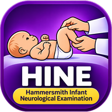

# HINE — Hammersmith Infant Neurological Examination

Scoring, risk interpretation, training and report tool for the **Hammersmith Infant Neurological Examination** (proforma v20.12.23).
Built for the Department of Paediatrics & Neonatology, Hospital Miri.

## Use it

| How | Steps |
|---|---|
| **Online** | Open the GitHub Pages link: `https://anncheng1.github.io/HINE-Assessment/` |
| **Install as an app (works offline)** | **Android / Chrome / Edge:** open the link, tap **⬇ Install app** in the header (or browser menu ⋮ → *Install app*). **iPhone / iPad:** open the link in **Safari** → Share ⬆︎ → **Add to Home Screen**. Open it once while online; after that it runs fully offline with the HINE icon. |
| **Download for offline use (no install)** | **Code → Download ZIP**, unzip, open `index.html` in any browser. Everything (images, chart library) is in the folder; no internet needed. |

## Features
- **Assessment:** all 26 items with examiner guidance and 📷 photo examples. Asymmetric items are scored **R and L separately and averaged** (e.g. 2 + 1 = 1.5), as in the case studies.
- **Summary:** global score /78, age-specific interpretation with preterm correction (Scoring Aid), and an asymmetry count with the poorer side and upper-limb involvement. **≥ 4 asymmetries prompts referral** to early intervention.
- **Training:** how to examine, scoring examples, interpreting scores, three interactive case studies, and a 34-photo scoring quiz. Scoring examples show real infant photos and proforma drawings for each score, with pinch-zoom on phones.
- Print / save as PDF and copy the report text.

## Updating
After changing any file, bump `VERSION` in `sw.js` so installed copies pick up the update.

## Sources
Mac Keith Press HINE proforma & guidance notes (Dec 2023) · Fehlings D et al., HINE Scoring Aid, *Dev Med Child Neurol* 2024 (doi:10.1111/dmcn.15977) · Training images from the HINE Introduction Webinar (July 2024), Scoring Examples and Case Studies (Holland Bloorview / Sunnybrook / Kids Brain Health Network / CP-NET), reproduced for internal training only. Chart.js (MIT) bundled in `vendor/`.
